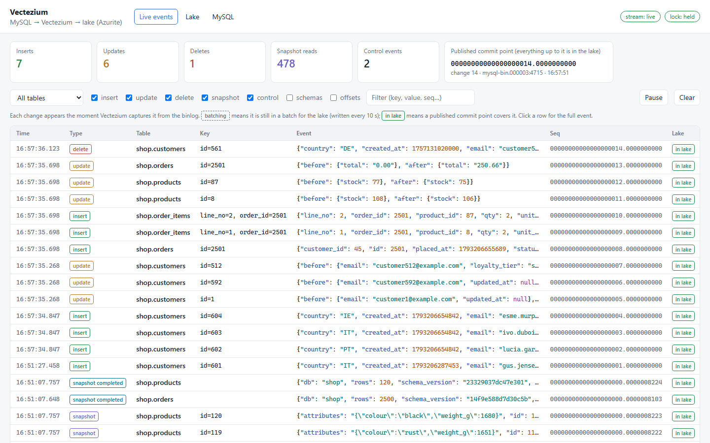
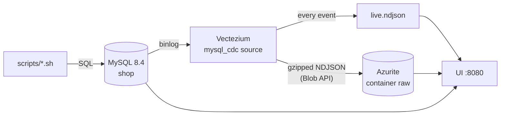

# Vectezium demo

**Vectezium** is [Vector](https://vector.dev) with change data capture (CDC) sources for MySQL
and PostgreSQL: it reads the MySQL binlog or a PostgreSQL logical replication slot and writes
every insert, update and delete straight into an Azure Data Lake landing zone, in the style of
[Debezium](https://debezium.io) but without Kafka or Kafka Connect. It is two patches to Vector
v0.60.0, applied in order: [`vectezium/mysql_cdc.patch`](vectezium/mysql_cdc.patch) (the MySQL
source and the shared CDC core) and [`vectezium/postgres_cdc.patch`](vectezium/postgres_cdc.patch)
(the PostgreSQL source).

This repository is a local, self-contained demo of it. One `docker compose up` starts:

- **MySQL 8.4** with a seeded `shop` database (customers, products, orders, order items), set up
  for CDC: row-based binlog, full row images and metadata, GTIDs
- **PostgreSQL 17** with the same shop (customers, products, orders) in schema `public`, set up
  for logical replication: `wal_level=logical`, a publication, `REPLICA IDENTITY FULL`
- **Vectezium**, built from source: Vector v0.60.0 with both patches applied
- **Azurite**, Microsoft's local Azure Storage emulator, standing in for ADLS Gen2
- **A web UI** on <http://localhost:8080>: live events as they are captured, a browser for the
  files in the lake, the source tables for comparison, and the licences, for either connector





## Quick start

You need Docker with Compose v2 (Docker Desktop, or Docker Engine on Linux/WSL), about 10 GB of
free disk space and 8 GB of memory for Docker.

```bash
git clone https://github.com/yokunade/Vectezium.git && cd Vectezium
docker compose up -d --build
```

The first build compiles Vector from source, which takes 10-30 minutes depending on the machine.
Later builds reuse the cargo cache. When the build finishes, open <http://localhost:8080>.

**Sign in** as `admin` with password `admin`. On first sign-in the UI asks you to choose a new
password (at least 8 characters, letters plus a number or symbol) before showing anything. Users
and sessions are stored in `auth.db` on the `ui-data` volume, so the new password survives
restarts; `./scripts/reset.sh` deletes it and brings back `admin` / `admin`. Sessions last 12
hours (`SESSION_HOURS` on the `ui` service).

On start, Vectezium takes an **incremental snapshot** of the four captured tables (about 8,000
rows read in chunks while it already streams the binlog), then captures every change as it
commits.

The scripts are bash. On Windows, run them from WSL or Git Bash.

### Choosing the connector

The demo has two connectors: `shop` (MySQL, the default) and `shop_pg` (PostgreSQL, see
[PostgreSQL](#postgresql)). Every script works on either one. Add `--connector postgres` (or
`--postgres`) anywhere in its arguments, or set `CONNECTOR=postgres` for a whole shell session:

```bash
./scripts/changes.sh --connector postgres insert 3
CONNECTOR=postgres ./scripts/simulate.sh 120 10
./scripts/snapshot.sh --connector postgres public.products   # PostgreSQL tables are public.<table>
```

In the UI, the source connector dropdown next to the logo picks what every tab shows: **All
connectors** (the default), **MySQL** or **PostgreSQL**. `C` cycles through them. With all
connectors, the live feed merges both streams with a Source column, the commit point card has a
line per connector, the lake shows both folders and the database tab both databases. The choice is
remembered, and a link such as <http://localhost:8080/?connector=postgres> opens one.

## Things to try

### a) Inserts, updates and deletes

```bash
./scripts/changes.sh insert 3      # three new customers
./scripts/changes.sh update 2      # change the loyalty tier and email of two customers
./scripts/changes.sh delete 1      # delete a customer who has no orders
./scripts/changes.sh order         # one transaction: an order, its lines, product stock
                                   #   (PostgreSQL has no order lines: an order and product stock)
./scripts/changes.sh stream 120    # a random mix of all of the above for two minutes
./scripts/changes.sh sql "UPDATE products SET price = price * 1.1 WHERE id = 7"
./scripts/simulate.sh 120 10       # shop traffic: inserts and updates across all tables, 10/s
```

Each script prints the SQL it runs. In the **Live events** tab every change appears as soon as
Vectezium reads it from the binlog, as JSON: the new row for inserts, only the changed columns
(`before` and `after`) for updates, and the deleted row for deletes. Click an event to see all
of it. Each event starts as *batching* and turns *in lake* once a published commit point covers
it, meaning its file has been written. Files are written every 10 seconds.

### b) An ad-hoc incremental snapshot

```bash
./scripts/snapshot.sh shop.products            # one or more tables
./scripts/snapshot.sh --all
./scripts/snapshot.sh --dismiss shop.orders    # a held table: mark it as snapshotted instead
```

The table's current rows are read again in chunks of 250, as `snapshot` events (op `r`,
`metadata.snapshot: "incremental"`), while changes keep streaming. Each table ends with a
`snapshot completed` control event.

Vectezium does not take snapshot requests while it runs (it has no Debezium-style signal table).
It keeps the list of tables it has snapshotted in its offset file, and on start it snapshots
every captured table missing from that list. So the script stops Vectezium, which stores its last
acknowledged offset and releases its lock first. It then removes the tables from that list
([`ui/resnapshot.py`](ui/resnapshot.py)) and starts Vectezium again.

### c) Add a new table and redeploy

```bash
./scripts/add-table.sh             # creates shop.reviews; or ./scripts/add-table.sh <name>
```

The script adds a table the way you would in a real deployment:

1. Create the table, with 300 rows. Vectezium ignores it because it is not in the connector's
   `table_include_list`.
2. Add it to `table_include_list` in [`vectezium/vectezium.yaml`](vectezium/vectezium.yaml).
3. Redeploy Vectezium, which starts a new container with the new config. Vectezium finds a
   captured table it has never snapshotted and snapshots it incrementally
   (`snapshot_new_tables: true`), while it keeps streaming the others.

Its schema document, its 300 rows and then its live changes appear in the UI and in the lake
under `cdc/shop/shop/reviews/`.

### d) Lose Vectezium's offsets

```bash
./scripts/lose-offsets.sh          # stop Vectezium, delete offsets.json, start it again
```

This is what happens when Vectezium is redeployed to a new container without its old data
directory. Without help it would start over: snapshot every table again and number `seq` from 1
into a lake that already has those numbers. With `offset_recovery` (in
[`vectezium/vectezium.yaml`](vectezium/vectezium.yaml)) it reads the offset it last published,
`_offsets/latest.json`, which carries the whole stored offset as `checkpoint`. It resumes from
there with the same binlog position, `seq` numbering and list of snapshotted tables, and takes
no new snapshot. Changes after that offset are read again with the `seq` they already had.

At start, with no stored offset, Vectezium decides like this:

| The lake has | Vectezium |
|---|---|
| `_offsets/latest.json` | Resumes from it |
| Nothing under `cdc/shop/` but the lock | Starts from scratch (first start) |
| Other data, but no `latest.json` | Refuses to start and lists what it found |
| Something it cannot read | Retries every 5 seconds; never treats it as "nothing there" |

### Snapshots nobody asked for

`unplanned_snapshots: hold` keeps Vectezium from re-reading tables without warning. Snapshots
you ask for run as usual: the first start, `add-table.sh` and `snapshot.sh`. Two other cases
wait for you:

- **The binlog was purged** past Vectezium's offset (`snapshot_mode: when_needed`). Every table
  would have to be read again, so Vectezium refuses to start and says why.
  `./scripts/snapshot.sh --all` approves the re-snapshot.
- **A table's snapshot state was lost**, for example after recovering from a `latest.json`
  written before `checkpoint` existed. Vectezium streams the table's changes but does not read
  its existing rows. It lists the table in `held_tables` of its offset file, logs a warning,
  sends a `snapshot held` control event, and the UI shows a banner. Release it with
  `./scripts/snapshot.sh shop.<table>` (snapshot it) or
  `./scripts/snapshot.sh --dismiss shop.<table>` (mark it as complete without reading it).

### Start over

```bash
./scripts/reset.sh                 # deletes all data and removes tables added by add-table.sh
docker compose up -d
```

## What lands in the lake

Everything goes to the `raw` container under `cdc/shop/` (`shop` is the connector name):

| Path | Contents |
|---|---|
| `shop/<table>/date=YYYY-MM-DD/<uuid>.json.gz` | Row changes, one per line: `c`, `u`, `d`, and `r` (snapshot) |
| `_control/date=YYYY-MM-DD/<uuid>.json.gz` | `schema_change`, `truncate`, `snapshot_completed`, `snapshot_held` |
| `_schemas/shop/<table>/<schema_version>.json` | One document per table definition: columns, types, key |
| `_offsets/latest.json`, `_offsets/history/…` | Published commit points: every event with `seq` ≤ it is in the lake. `checkpoint` holds the full offset, for recovery |
| `_lock` | The single-writer lease. Only one Vectezium instance captures at a time |

A row change looks like this (`record_images: before_and_after`):

```json
{"metadata": {"op": "u", "seq": "00000000000000000042.0000000000", "db": "shop", "table": "customers",
              "key": {"id": 270}, "commit_ts_ms": 1793205553293, "gtid": "…:21", "schema_version": "6c26742f2de7330c", …},
 "record":   {"before": {"id": 270, "loyalty_tier": "gold",   "email": "customer270@example.com", …},
              "after":  {"id": 270, "loyalty_tier": "silver", "email": "customer270@example.org", …}}}
```

`record.before` is `null` for inserts and snapshot reads. For a delete (`metadata.deleted: true`),
`record.before` is the deleted row and `record.after` holds only its key, for example
`{"order_id": 2501, "line_no": 1}`: the primary key, or the `pk_override` columns if set. So every
event has the row's key in `record.after`. Files written before this format have the row in
`record` and the previous one in a top-level `before`.

Apply changes in `metadata.seq` order: it is one sequence across all tables, and replayed events
keep the same `seq`. `customers.password_hash` never leaves MySQL because of
`column_exclude_list`. Compare the **MySQL** tab with a row file in the **Lake** tab.

You can also browse the lake with [Azure Storage Explorer](https://azure.microsoft.com/products/storage/storage-explorer):
connect to *Local storage emulator* on port 10000. MySQL is on `localhost:3307`, user `app`,
password `app-demo-pw`; PostgreSQL on `localhost:5433`, database `shop`, the same user and
password.

## PostgreSQL

The second connector, `shop_pg`, captures the PostgreSQL shop with the `postgres_cdc` source and
writes it to `cdc/shop_pg/` in the same layout as `cdc/shop/`: row files per table under
`cdc/shop_pg/public/<table>/`, plus `_control/`, `_schemas/` and `_offsets/`. On its first start
it creates the replication slot `vectezium` and streams every committed change from there, while
it reads the three tables (2,220 rows) in chunks of 250: an incremental snapshot, like the MySQL
connector's. Switch the UI to **PostgreSQL** to watch it.

Every script in [Things to try](#things-to-try) works on it with `--connector postgres`.
`simulate.sh` also appends tags to the customers' `tags` array, and `add-table.sh` adds the new
table to the publication `vectezium` (as the superuser: the publication is the DBA's) instead of
editing the config. Or make changes by hand as the application user:

```bash
./scripts/changes.sh --connector postgres insert 2
./scripts/changes.sh --connector postgres sql "UPDATE customers SET loyalty_tier = 'gold' WHERE id = 1"
./scripts/changes.sh --connector postgres sql "DELETE FROM orders WHERE id = 7"
./scripts/changes.sh --connector postgres sql "ALTER TABLE products ADD COLUMN discontinued boolean DEFAULT false"
./scripts/changes.sh --connector postgres sql "UPDATE products SET discontinued = true WHERE id = 3"
```

Each change lands in `cdc/shop_pg/public/<table>/` within 10 seconds. PostgreSQL does not stream
DDL: it describes a table again before the table's next change. So the `UPDATE` after the
`ALTER TABLE` is what brings a `schema_change` event to `_control/` (the columns added, removed or
retyped) and a new schema document. Watch the slot with
`docker compose exec postgres psql -U postgres -d shop -c "SELECT slot_name, confirmed_flush_lsn, wal_status FROM pg_replication_slots"`:
`confirmed_flush_lsn` only moves to an offset that has been published to the lake.

What the source needs from a server, and how it behaves:

- **Server.** PostgreSQL 13 or newer with `wal_level=logical`. Set `max_slot_wal_keep_size` so a
  stuck slot is invalidated instead of filling the disk.
- **User.** The `REPLICATION` attribute and `SELECT` on the captured tables. With
  `publication_autocreate_mode: filtered` (the default) it creates the publication itself, which
  needs ownership of the tables; the demo creates it in
  [`postgres/init/02-shop.sql`](postgres/init/02-shop.sql) and sets `disabled`.
- **Before images.** Tables need `REPLICA IDENTITY FULL` for full `before` images. Without it,
  updates carry no `before`, deletes only the key, and unchanged large (TOASTed) values the
  placeholder `__debezium_unavailable_value`. The source warns at start-up.
- **Events.** As Debezium's PostgreSQL connector: `source.connector` is `postgresql`, `source.db`
  the database and `source.schema` the schema; types map the same way (`timestamptz` as a UTC
  ISO-8601 string, arrays as JSON arrays, `interval` in microseconds or ISO-8601). In the record
  format `metadata.db` is the schema, so the lake layout matches MySQL's.
- **Offsets and the slot.** An offset is the end of a commit record. The source tells the server
  it may discard WAL only up to the last published offset, so a source that lost its data
  directory can always resume from the lake (`offset_recovery`). While nothing captured changes,
  it still moves the slot on, so other databases' writes do not pile up WAL.
- **A lost slot.** If the slot is invalidated or dropped, the source refuses to start, unless
  `snapshot_mode: when_needed` (then the re-snapshot waits for approval with
  `unplanned_snapshots: hold`, as for MySQL: set `"resnapshot_approved": true` in its offset
  file).
- **Snapshots.** `snapshot_strategy: blocking` reads every table in the slot's exported snapshot
  before streaming. `incremental` (the demo's) streams at once and reads tables in key order, in
  chunks, each one short transaction: Debezium's read-only incremental snapshot, using
  `pg_current_snapshot()` to tell which streamed changes are newer than a chunk. Tables need a
  primary key (or `pk_override`). With `snapshot_new_tables: true`, a table added to the
  publication later is snapshotted the same way when the source next starts, and so is a table
  queued for an ad-hoc snapshot:

  ```bash
  ./scripts/snapshot.sh --connector postgres public.products
  ```

## Running it against real Azure storage

[`vectezium/vectezium.yaml`](vectezium/vectezium.yaml) is a complete connector config. To run it
for real, change these demo settings:

- **Storage.** The demo uses Azurite with its well-known connection string. Use a real storage
  account instead, ideally with a managed identity. Azurite only emulates the Blob service, not
  the ADLS Gen2 `dfs` endpoint. Vectezium writes through the Blob API, which ADLS Gen2 accounts
  also serve, so the paths and files are the same.
- **Batching.** Row files are written every 10 seconds here so the demo is quick to watch. A few
  minutes (for example 5) gives fewer, larger files.
- **TLS.** TLS to MySQL is off here. Turn it on and verify the server's certificate.
- **The `live` sink** writes every event to a local file for the UI. Remove it.

## Repository layout

| Path | |
|---|---|
| `docker-compose.yml` | The whole demo |
| `vectezium/Dockerfile` | Builds Vectezium: Vector v0.60.0 (pinned commit) + both patches, on a distroless base |
| `vectezium/mysql_cdc.patch` | The `mysql_cdc` source, the shared CDC core and the `azure_blob` sink options, as a patch to Vector |
| `vectezium/vectezium.yaml` | The connector config |
| `vectezium/NOTICE`, `LICENSE-3rdparty-mysql_cdc.csv` | Notices for Vectezium (see [Licence](#licence)) |
| `mysql/init/` | Users and the seeded `shop` database (runs on the first start) |
| `postgres/init/` | The PostgreSQL users, shop and publication (runs on the first start) |
| `vectezium/postgres_cdc.patch` | The `postgres_cdc` source, as a patch on top of `mysql_cdc.patch` |
| `ui/` | The web UI (FastAPI) and its sign-in (`auth.py`), plus `init_storage.py` and `resnapshot.py` |
| `scripts/` | `changes.sh`, `simulate.sh`, `snapshot.sh`, `add-table.sh`, `lose-offsets.sh`, `reset.sh` |
| `docs/` | The screenshot above |
| `LICENSE` | The Mozilla Public License 2.0 |

All passwords in this repository are demo values for local containers. The UI's sign-in keeps
the demo off-limits to other people on your network, but it serves plain HTTP: put it behind
TLS before exposing it anywhere else.

## Licence

Copyright (c) 2026 yokunade.

Everything in this repository is licensed under the
[Mozilla Public License 2.0](https://www.mozilla.org/MPL/2.0/) (MPL-2.0). See [`LICENSE`](LICENSE).

Vectezium is a modified version of [Vector](https://github.com/vectordotdev/vector), which is
also licensed under the MPL-2.0. [`vectezium/mysql_cdc.patch`](vectezium/mysql_cdc.patch)
changes some of Vector's files and adds new ones.

| File | |
|---|---|
| [`vectezium/NOTICE`](vectezium/NOTICE) | What Vectezium is built from, and Vector's own NOTICE (Datadog copyright, OpenSSL notices) |
| [`vectezium/LICENSE-3rdparty-mysql_cdc.csv`](vectezium/LICENSE-3rdparty-mysql_cdc.csv) | The Rust crates the patch adds (`mysql_async`, `mysql_common`, `btoi`, `keyed_priority_queue`, `saturating`). All are MIT or MIT/Apache-2.0 |

The **Licences** tab in the UI shows them too. The Vectezium image carries Vector's licence, the
NOTICE and a copy of the patch in `/usr/share/doc/vectezium/`. It also has Vector's
`LICENSE-3rdparty.csv` with the added crates appended. Its `org.opencontainers.image.licenses`
label is `MPL-2.0`.

The source of Vectezium is Vector at the commit pinned in
[`vectezium/Dockerfile`](vectezium/Dockerfile) plus the patch. If you share the image or the
binary, the MPL-2.0 requires that you:

- make the source available to recipients and tell them how to get it, for example with a link
  to this repository.
- leave the licence and notice files in place.
- license any changes you make to MPL-2.0 files under the MPL-2.0 too.

### Third-party software the demo runs

The demo pulls these at build or start time. It does not redistribute them, and each keeps its
own licence:

| Software | Used for | Licence |
|---|---|---|
| [MySQL Community Server](https://www.mysql.com/) 8.4 (`mysql` image) | The MySQL source database | GPL-2.0, with Oracle's FOSS exception |
| [PostgreSQL](https://www.postgresql.org/) 17 (`postgres` image) | The PostgreSQL source database | PostgreSQL License |
| [Azurite](https://github.com/Azure/Azurite) | The local stand-in for Azure Storage | MIT |
| [FastAPI](https://fastapi.tiangolo.com/), [Uvicorn](https://www.uvicorn.org/), [PyMySQL](https://github.com/PyMySQL/PyMySQL), [pg8000](https://github.com/tlocke/pg8000), [Azure Storage Blobs for Python](https://github.com/Azure/azure-sdk-for-python) | The UI | MIT; Uvicorn and pg8000 BSD-3-Clause |
| [distroless](https://github.com/GoogleContainerTools/distroless), `rust` and `python` base images | Building and running the containers | Apache-2.0; their packages carry their own licences |

## Acknowledgements

- **[Vector](https://vector.dev)** by Datadog is what Vectezium is built on. See [Licence](#licence).
- **[Debezium](https://debezium.io)** is the model for the change event format, the value
  representations and the incremental snapshot behaviour. `event_format: debezium` emits
  Debezium-compatible events. Vectezium contains no Debezium code.
- **Incremental snapshots** use the watermark algorithm from A. Andreakis and I. Papapanagiotou,
  [*DBLog: A Watermark Based Change-Data-Capture Framework*](https://arxiv.org/abs/2010.12597)
  (Netflix, 2020), in its read-only form, as Debezium does for MySQL.

## Trademarks

Vectezium is an independent project. It is not affiliated with or endorsed by Datadog (Vector),
the Debezium project, Oracle (MySQL) or Microsoft (Azure). Their names are used only to describe
what Vectezium is built on, is compatible with or works with. The MPL-2.0 grants no rights to
Vector's trademarks.
